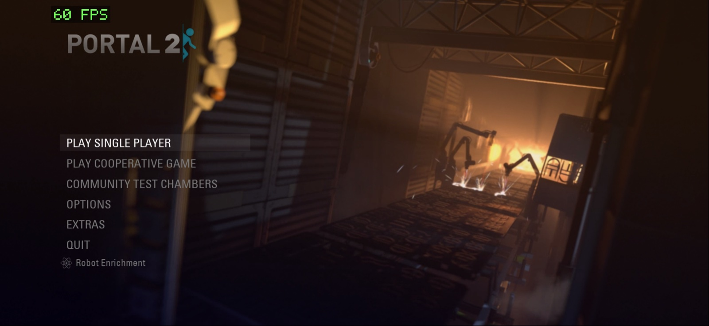
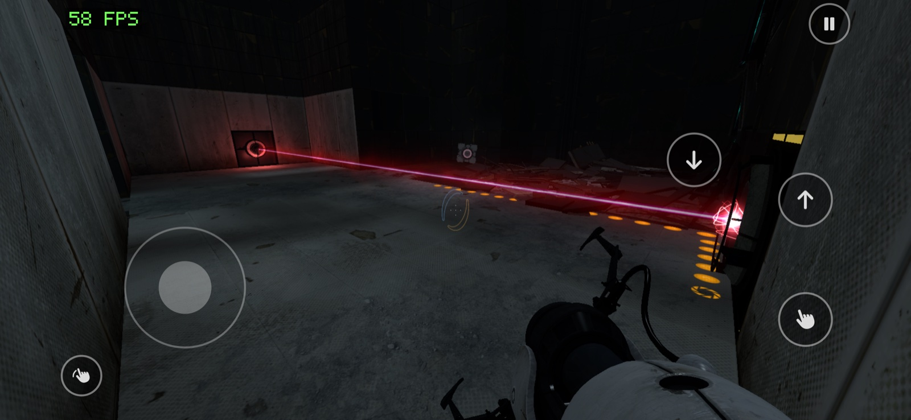

# Portal 2, statically recompiled for Apple silicon (macOS and iPhone)

[](https://youtu.be/YWX2BeMnlQI)

*Video: Portal 2 running natively on an iPhone 15 Pro Max.*

<p>
  
  
</p>

This project translates the **x86 (i386) machine code of Portal 2's Linux
release into C**, then compiles it into a native ARM64 executable for macOS
and iOS. No emulator, no Wine, no Rosetta, no interpreter: every function of
the game's 31 Linux modules (engine, game DLL, renderer, materials, sound,
VGUI, ...) becomes a C function, and a small runtime supplies what the Linux
binaries expect from the outside world (glibc, pthreads, SDL2, OpenGL, Steam).

- **macOS**: fully playable, 235-280 fps on an M3 Pro (1280×720 to 1512×982).
- **iPhone**: fully playable on an iPhone 15 Pro Max, a locked 60 fps with
  4× MSAA, touch controls, and portals fired by **tapping the back of the
  phone** (left or right side, detected with the accelerometer and gyroscope).

**You must own the game.** This repository contains no game files, no Valve
code and no decompiled source. Everything is generated on your machine from
your own copy of Portal 2, and the result is for your own use only: **do not
share the built app or the generated code**, they contain Valve's game.

> Unofficial fan project, not affiliated with or endorsed by Valve. Portal,
> Portal 2, Steam and Source are trademarks of Valve Corporation. Provided as
> is, without warranty (see [LICENSE](LICENSE)).

## How it works

1. **Preparation** (`tools/gameprep.py`, `tools/elfprep.py`): the i386 ELF
   modules of the Linux release are loaded at fixed guest addresses and
   relocated, as the Linux dynamic loader would.
2. **Lifting** (`tools/lift.py`, `tools/float_lift.py`): every known function
   (symbols, exports, init arrays, code pointers found in data, vtables) is
   disassembled and translated instruction by instruction into C operating on
   a guest CPU state and a 4 GiB guest address space. Branches become C
   branches, calls become C calls, x87 and SSE become host floating point. The
   full game is about **125,000 functions and 15 million instructions**, split
   in ~320 C files compiled in parallel and cached. An instruction or import
   that is not supported is never silently skipped: it becomes a trap that
   stops the game with its address.
3. **Runtime** (`runtime/`): guest memory, threads (serialized on a guest
   lock with yield points), TLS, futexes, and bridges for the Linux imports
   the game uses: libc, pthreads, SDL2, OpenGL (through Valve's own
   `togl` D3D9-to-GL layer), OpenAL, Fontconfig/FreeType, and Steam (the
   official Steamworks `libsteam_api.dylib` on macOS, a minimal offline stub
   on iOS).
4. **iOS** (`runtime/ios/`, `ios/`): OpenGL 2.1 is turned into OpenGL ES 3 by
   a patched [gl4es](https://github.com/ptitSeb/gl4es), with shader rewrites
   for sRGB, texture borders and vertex color swizzling; a UIKit overlay
   provides the touch controls; an iOS Settings page exposes the options.

More details: [docs/ios.md](docs/ios.md) (iOS port, controls, settings),
[docs/steam.md](docs/steam.md) (Steam bridge),
[docs/fast-path.md](docs/fast-path.md) (fast memory mode),
[docs/gl-audit.md](docs/gl-audit.md),
[docs/lifter-coverage.md](docs/lifter-coverage.md), and
[STATUS.md](STATUS.md), the development log with every measurement.

The code comments and commit messages are in French; the documentation is in
English.

## What you need

- An Apple silicon Mac with the Xcode command line tools (their LLVM
  `objdump` disassembles the game), Python 3, and Homebrew's `sdl2`,
  `freetype` and `fontconfig` for the macOS build.
- **Portal 2 on Steam.** Two parts of it:
  - the game data: your normal Portal 2 install folder (the Windows release
    works, e.g. installed through Whisky/CrossOver), the one containing
    `portal2/`, `platform/` and `bin/`;
  - the **Linux binaries** (Steam depot 661). With your Steam account, in
    [SteamCMD](https://developer.valvesoftware.com/wiki/SteamCMD) or the
    Steam console: `download_depot 620 661`.
- For macOS: Valve's macOS `libsteam_api.dylib` from SDK 1.53a, as shipped in
  the [Steamworks.NET 20.1.0](https://github.com/rlabrecque/Steamworks.NET/releases/tag/20.1.0)
  Unity package (`steam_api.bundle`). The game starts through Steam and needs
  the Steam client running and signed in.
- For iOS: Xcode, [XcodeGen](https://github.com/yonaskolb/XcodeGen), CMake
  and Ninja (`brew install xcodegen cmake ninja`), an
  Apple account (a free one works, with 7-day provisioning profiles) and
  ~12 GB of free space on the device. Tested on an iPhone 15 Pro Max (A17
  Pro, 8 GB); older or smaller iPhones are untested.

Then create `config/local.json` (ignored by git):

```json
{
  "game_root": "/path/to/Portal 2",
  "linux_root": "/path/to/depot_661",
  "steam_appid": 620,
  "steam_api_dylib": "/path/to/steam_api.bundle/Contents/MacOS/libsteam_api.dylib",
  "ios_bundle_id": "com.yourname.portal2"
}
```

`ios_bundle_id` must be unique to your Apple account (free accounts cannot
share identifiers); it can also be given with `P2_BUNDLE_ID`.

## Build and play on macOS

```sh
python3 tools/gameprep.py                 # prepare the Linux modules (seconds)
python3 tools/build_game.py --release     # lift and compile (~10 min the first time)
python3 tools/run_game.py --show --timeout 3600
python3 tools/make_app.py                 # optional: an app for the Dock / Finder
```

Saves and settings go to `../work/portal2-userdata`, next to this folder;
the game folder is never written to.

## Build and play on iPhone

```sh
python3 tools/gameprep.py                         # if not done for macOS
ios/deps/build.sh device                          # SDL2, FreeType, gl4es (once)
python3 tools/build_ios.py --target device --release
tools/ios_device.sh install                       # iPhone connected by cable, unlocked, Developer Mode on
tools/ios_device.sh data                          # copy the game data to the app (~11.5 GB, once)
```

The first device build needs a provisioning profile: see
[ios/signing/project.yml](ios/signing/project.yml) and
[docs/ios.md](docs/ios.md). The simulator works too
(`ios/deps/build.sh sim`, `python3 tools/build_ios.py`, then
`tools/run_ios_sim.sh`), but renders in
software and shows clipping artifacts that do not exist on the device.

**Controls**: left stick to move, right half of the screen to look (stick
or trackpad), buttons for jump, crouch, use and pause; tap the back of the phone on
the left or right to fire the blue or orange portal. Everything can be
tuned in the iOS Settings app, under Portal 2.

## Tests

```sh
make test INPUT_DIR=/path/to/depot_661/bin       # runtime and ABI checks against the real binaries
make sanitize INPUT_DIR=/path/to/depot_661/bin   # the same with UBSan
```

`INPUT_DIR` defaults to `../work/portal2-linux/bin`.

## Limits

- iOS is single player and offline: no co-op, achievements or Steam features.
- Built and tested against one specific release of the Linux binaries
  (depot 661, manifest 8940703274703023246); another build needs new indirect
  call roots (`config/game-roots.json`, `tools/discover_game.py`).
- x87 is computed in `double` precision, not 80-bit.
- The free Apple account limits a device to 3 sideloaded apps and 7-day
  profiles; rebuild and reinstall to renew.

## How it was made

Built in a few days of October 2026 by Raphaël Kanapitsas, with AI coding
agents (Anthropic's Claude Code and OpenAI's Codex) writing most of the code
under his direction; the history and [STATUS.md](STATUS.md) show the whole
process.

## Credits

- [gl4es](https://github.com/ptitSeb/gl4es) (MIT) by ptitSeb, patched in
  `ios/deps/gl4es-ios.patch`.
- [SDL2](https://libsdl.org) (zlib), [FreeType](https://freetype.org) (FTL).
- [Steamworks.NET](https://github.com/rlabrecque/Steamworks.NET) (MIT), whose
  interface metadata generates the Steam bridge.
- Touch controls inspired by
  [MacNativeGames](https://github.com/ly05010419/MacNativeGames) (MIT).

## License

The code in this repository is licensed under the GNU General Public License
v3.0 ([LICENSE](LICENSE)). It does not cover Portal 2 or any Valve material,
which remain the property of Valve Corporation.
